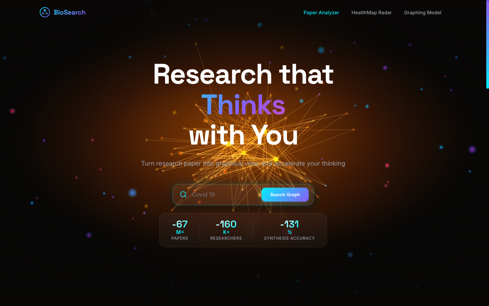
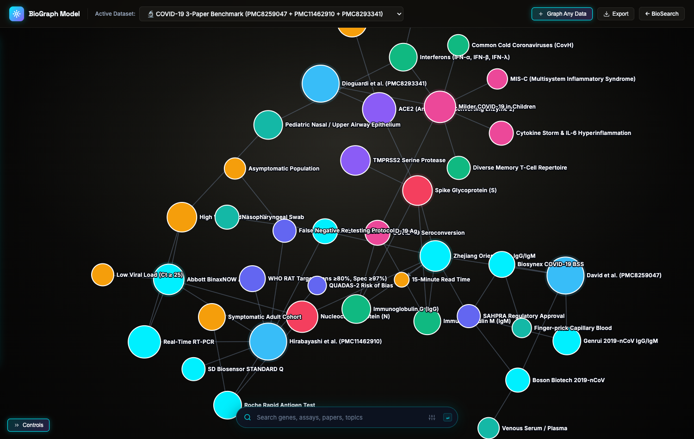
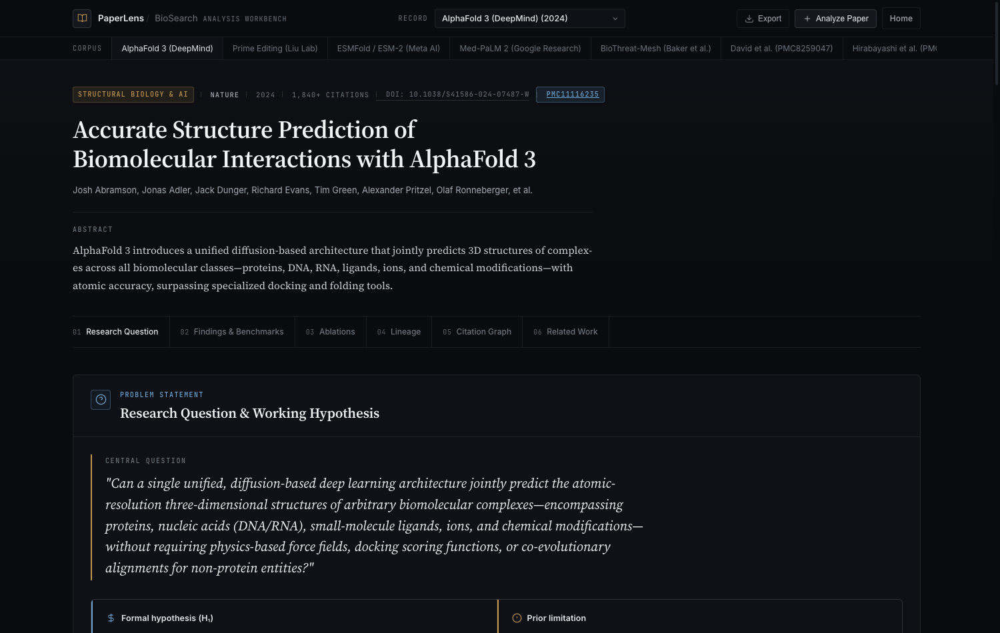
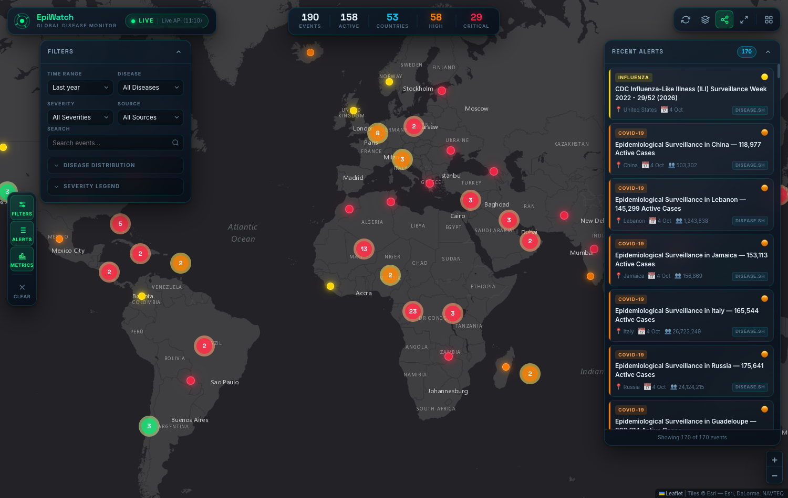
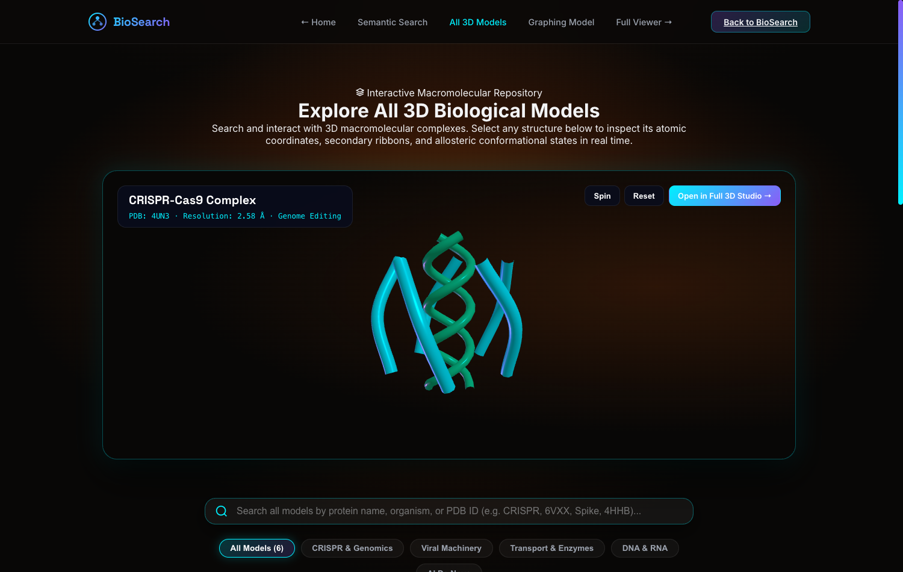

# 🧬 BioSearch

<div align="center">

**Autonomous Multi-Modal Biomedical Literature Intelligence, 3D Macromolecular Exploration & Planetary Outbreak Surveillance**

[](LICENSE)
[](https://www.python.org/downloads/)
[](https://fastapi.tiangolo.com)
[](https://threejs.org/)
[](https://d3js.org/)
[](https://ai.google.dev/)

[Quick Start](#-quick-start) •
[Modules Overview](#-core-platform-modules) •
[Screenshots](#-platform-showcase) •
[CLI Pipeline](#-cli-knowledge-graph-pipeline) •
[Configuration](#-configuration--environment-variables) •
[Architecture](#-repository-architecture)

</div>

---

## 📌 Overview

**BioSearch** is a next-generation biomedical intelligence platform combining real-time scientific literature indexing, interactive 3D molecular visualization, automated LLM knowledge graph synthesis, and planetary disease outbreak surveillance into a unified research workstation.

Built for life sciences researchers, epidemiologists, and bioinformaticians, BioSearch deconstructs complex biomedical queries into living entity topologies, dynamic hypothesis lineage trees, and real-time geospatial outbreak telemetry.

---

## 📸 Platform Showcase

<div align="center">

### 1. 3D Biomedical Literature Discovery & Particle Canvas


### 2. BioGraph Knowledge Graph Studio (Europe PMC + Gemini AI)


### 3. PaperLens Deep Research Intelligence & Topology Desk


### 4. Planetary Disease Outbreak Surveillance Radar


### 5. Interactive 3D Biological Macromolecule Viewer


</div>

---

## 🌐 Core Platform Modules

| Module | Access Path | Description |
| :--- | :--- | :--- |
| **BioSearch Main Hub** | [`/index.html`](index.html) | Interactive 3D paper cascade, living knowledge graph, and semantic query hub |
| **BioGraph Studio** | [`/knowledge-graph/demo.html`](knowledge-graph/demo.html) | 2D/3D physics-simulated knowledge graph with live Europe PMC retrieval & Gemini AI synthesis |
| **PaperLens Desk** | [`/paper-analyzer/index.html`](paper-analyzer/index.html) | Deep publication deconstruction: hypotheses, figures, ablations, lineage & citations |
| **Outbreak Radar** | [`/outbreak-radar/frontend/index.html`](outbreak-radar/frontend/index.html) | Planetary epidemiological surveillance aggregating WHO, CDC, ECDC, and Disease.sh telemetry |
| **3D Molecular Catalog** | [`/models.html`](models.html) | Interactive catalog of biological macromolecules and viral structures |
| **3D Structure Viewer** | [`/model-viewer.html`](model-viewer.html) | Full-screen GLTF/Three.js interactive macromolecule and protein visualizer |

---

## ⚡ Quick Start

### 1. Prerequisites
- **Python 3.8+** (for local HTTP server and optional backend services)
- Any modern web browser with WebGL enabled (Chrome, Edge, Firefox, Safari)

### 2. Clone the Repository
```bash
git clone https://github.com/iamumangv/BioSearch.git
cd BioSearch
```

### 3. Configure Environment Variables
Copy the template configuration file to `.env`:
```bash
cp .env.example .env
```
*(On Windows CMD: `copy .env.example .env`)*

Add your optional [Google Gemini API Key](https://aistudio.google.com/app/apikey) to `.env` for AI entity extraction:
```ini
GEMINI_API_KEY="your_api_key_here"
GEMINI_MODEL="gemini-2.0-flash"
PORT=8080
```

---

## 🚀 Running the Platform

### Option A: One-Click Launch (Windows)
Double-click [`start.bat`](start.bat) in the project root directory.
- Starts the local server on `http://localhost:8080`.
- Automatically opens your default web browser to the BioSearch home portal.
- To stop the server at any time, double-click [`stop.bat`](stop.bat) or press `Ctrl + C`.

### Option B: Terminal / Command Line (Cross-Platform)

```bash
# Start local development server on port 8080
python -m http.server 8080
```

Navigate to **`http://localhost:8080`** in your browser.

*(Alternative using Node.js: `npx serve . -p 8080`)*

---

## 🌍 Outbreak Radar Backend (Optional Live Aggregator)

The **Outbreak Radar** frontend includes pre-packaged verified outbreak datasets that run immediately with zero configuration. To launch the optional FastAPI live feed aggregator with background scraping:

```bash
cd outbreak-radar
pip install -r requirements.txt
uvicorn backend.main:app --host 127.0.0.1 --port 8000 --reload
```

- API Docs: `http://127.0.0.1:8000/docs`
- Health check: `http://127.0.0.1:8000/api/health`

---

## 🐍 CLI Knowledge Graph Pipeline

BioSearch includes an autonomous command-line tool to query PubMed Central / Europe PMC, extract biological entities and causal triplets, and export visualizer-ready datasets:

```bash
# Query literature and generate knowledge graph
python knowledge-graph/fetch_pmc_and_generate_graph.py --topic "CRISPR-Cas9 gene editing" --max-papers 3 --output crispr_graph.json
```

### CLI Options:
| Flag | Description | Default | Example |
| :--- | :--- | :--- | :--- |
| `--topic` | Scientific query or PMC identifiers | `"COVID-19 rapid antigen tests"` | `--topic "AlphaFold 3 complex"` |
| `--max-papers` | Number of articles to retrieve | `5` | `--max-papers 5` |
| `--gemini-api-key` | Google Gemini API Key | Reads from `.env` | `--gemini-api-key "AIzaSy..."` |
| `--model` | Gemini Model identifier | `gemini-2.0-flash` | `--model "gemini-2.0-flash"` |
| `--format` | Output structure (`json` or `triplets`) | `json` | `--format triplets` |
| `--output` | Destination JSON file | `stdout` | `--output results.json` |

---

## ⚙️ Configuration & Environment Variables

Key parameters in [`.env`](.env) (templated in [`.env.example`](.env.example)):

| Variable | Description | Default / Example |
| :--- | :--- | :--- |
| `GEMINI_API_KEY` | Google AI Studio API Key for LLM knowledge graph extraction | `"AIzaSy..."` |
| `GEMINI_MODEL` | Google Gemini model family | `"gemini-2.0-flash"` |
| `PORT` | Local HTTP development server port | `8080` |

> [!NOTE]
> `.env` is automatically ignored by Git (via `.gitignore`) so confidential API credentials will never be exposed.

---

## 📁 Repository Architecture

```text
BioSearch/
├── index.html                   # 🏠 Main portal & 3D literature discovery hub
├── models.html                  # 🧬 3D Macromolecule & viral structures catalog
├── model-viewer.html            # 🔬 Fullscreen 3D structure inspector (Three.js)
├── start.bat                    # ⚡ One-click Windows launch runner
├── stop.bat                     # 🛑 One-click Windows process terminator
├── README.md                    # 📖 Project documentation
├── .env.example                 # 📋 Public environment configuration template
├── .gitignore                   # 🛡️ Git ignore configuration
├── .nojekyll                    # 🚀 GitHub Pages static asset routing
│
├── knowledge-graph/             # 🕸️ BioGraph Knowledge Graph Studio
│   ├── demo.html                # Interactive force-directed knowledge graph application
│   ├── index.html               # Knowledge graph portal entry
│   ├── fetch_pmc_and_generate_graph.py # CLI paper retrieval & graph extraction tool
│   ├── presets/                 # Pre-computed multi-paper knowledge graphs
│   │   ├── cancer.json          # Oncology & tumor microenvironment dataset
│   │   ├── covid.json           # SARS-CoV-2 genomics & host receptor dataset
│   │   ├── dengue.json          # Flavivirus pathogenesis & vector transmission dataset
│   │   ├── malaria.json         # Plasmodium falciparum surface protein dataset
│   │   └── presets.js           # Client-side bundle for instant offline rendering
│   └── README.md                # BioGraph technical documentation
│
├── outbreak-radar/              # 🌍 Planetary Outbreak Surveillance Radar
│   ├── frontend/                # Interactive geospatial surveillance dashboard
│   │   ├── index.html           # Dark-mode Leaflet telemetry interface
│   │   ├── css/style.css        # Cyber-epidemiology styling
│   │   ├── data/seed-events.js  # Verified outbreak epicenters & alert feeds
│   │   └── js/app.js            # Telemetry feed parser & map rendering engine
│   └── backend/                 # FastAPI outbreak surveillance pipeline
│       ├── main.py              # Application entry point
│       ├── requirements.txt     # Backend dependencies
│       ├── models/              # SQLite database models
│       ├── routers/             # Outbreak telemetry API endpoints
│       └── services/            # Fetchers (WHO, CDC, ECDC) & scheduler
│
├── paper-analyzer/              # 📑 PaperLens: Deep Research Intelligence Desk
│   ├── index.html               # PaperLens reading desk interface
│   ├── css/style.css            # Minimalist academic reading design system
│   └── js/
│       ├── analyzer.js          # Reactive UI, section rendering & synthesis
│       ├── graph-visualizer.js  # Force-directed citation & concept topology simulation
│       └── papers-data.js       # Pre-indexed benchmark papers (AlphaFold 3, etc.)
│
├── css/                         # 🎨 Core design tokens, typography & modules
│   ├── variables.css            # Color systems, spacing & elevations
│   ├── navbar.css               # Unified top navigation header
│   ├── hero.css                 # 3D paper falling scene & parallax layout
│   ├── advanced-search.css      # Semantic filter modals & query controllers
│   ├── healthmap-section.css    # Embedded outbreak radar widget styles
│   └── models.css               # 3D models showcase grid styling
│
├── js/                          # ⚡ Frontend orchestration & 3D engines
│   ├── main.js                  # Primary application entry point & animation loop
│   ├── ui.js                    # Search handlers, autocomplete & modal triggers
│   ├── catalog.js               # 3D models catalog rendering
│   ├── model-viewer.js          # Interactive macromolecule canvas controller
│   ├── healthmap-preview.js     # Embedded home radar mini-canvas
│   └── three/                   # Three.js 3D visualization subsystem
│       ├── scene.js             # Camera, renderer & ambient lighting setup
│       ├── graph.js             # 3D living biological particle network
│       ├── paper.js             # 3D cascading research preprint cards
│       └── textures.js          # Procedural biomedical textures & shaders
│
└── screenshots/                 # 🖼️ Platform architecture & UI previews
```

---

## 🛠️ Technology Stack

- **Frontend & Rendering:** Vanilla ES6+ JavaScript, Three.js (r128), D3.js (v7), Leaflet.js, Canvas2D API, Modern CSS3 Glassmorphism
- **Literature & Data APIs:** Europe PMC REST API, NCBI Entrez E-utilities, WHO DON, CDC HAN, Disease.sh
- **AI & Synthesis:** Google Gemini API (`gemini-2.0-flash`, `gemini-1.5-flash`), Rule-Based Biomedical Entity Regular Expressions
- **Backend (Surveillance):** Python 3.8+, FastAPI, Uvicorn, SQLite, APScheduler, Requests, BeautifulSoup4

---

## 📄 License

This project is open-source under the [MIT License](LICENSE).
